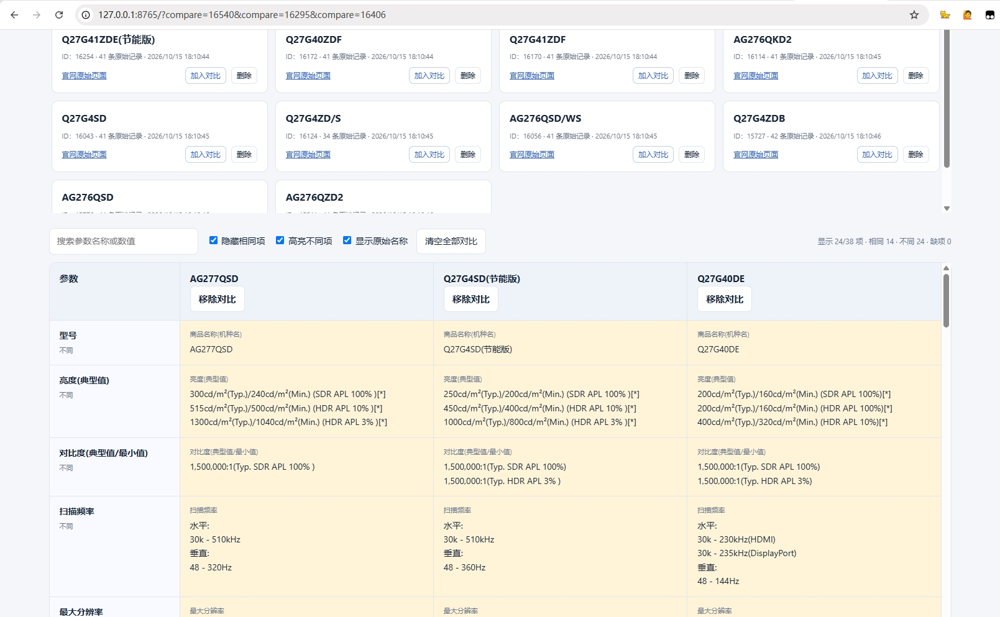

# AOC 显示器参数获取与对比工具

从 AOC 官网获取产品参数，保存到本地 SQLite 数据库，在同一张表中对比不同型号。仅供个人选购参考，非 AOC 官方产品。



## 功能

- 批量输入官网产品链接，按产品 ID 去重并自动保存。
- 按型号或 ID 搜索已保存产品，按需加入、移除或清空对比。
- 参数按名称对齐，支持搜索、隐藏相同项、高亮不同项，保留原始描述、脚注和来源链接。
- URL 自动保存对比选择，收藏地址后可恢复产品及顺序。
- 支持复制型号、删除本地产品记录。

## 快速开始

需要 Python 3.9+（含标准库 `sqlite3`）、现代浏览器，以及项目目录的写入权限。无需第三方依赖、API Key 或 AI 服务。

在项目目录运行：

```shell
python aoc_server.py
```

打开终端打印的地址，默认是 `http://127.0.0.1:8765/`。端口被占用时可运行 `python aoc_server.py --port 8766`，按 `Ctrl+C` 停止服务。请通过本地服务访问，不要直接双击 HTML。

1. 从 AOC 官网复制产品详情页链接，每行一个，格式为 `https://www.aocmonitor.com.cn/product-数字.html`。
2. 点击“获取产品”，成功后在“待对比产品”列表中点击“加入对比”。
3. 使用表格筛选项查看差异；收藏当前地址可保存对比组合。

移除或清空对比不会删除产品。URL 只保存选择，不包含参数；恢复时对应产品须已存在于本地数据库。

## 数据与更新

- 数据库 `aoc_parameters.sqlite3` 在首次启动时自动创建，已保存的产品不会重复获取或自动更新。
- 更新某款产品：在待对比列表中确认删除后，重新获取其官网链接。删除无法撤销。
- 备份或迁移：先停止服务，再复制数据库文件。
- “未列出”表示官网未提供该项，不代表产品不支持；工具不自动换算单位或评判产品优劣。

## 主要文件

- `aoc_server.py`：本地服务、参数抓取与 SQLite 数据管理。
- `aoc_compare.html`：产品列表与参数对比页面。
- `001_create_aoc_products.sql`：可重复执行的建表脚本。

## 使用边界

仅获取实际关注的少量型号，不用于全站采集、ID 扫描或高频请求，不绕过官网访问限制，不将本地服务部署到公网。遇到获取失败，请检查链接、网络及官网是否限制访问，避免频繁重试。

产品参数及内容归各自权利人所有，数据可能随官网更新；购买前请以官方最新信息和可靠实测为准。
